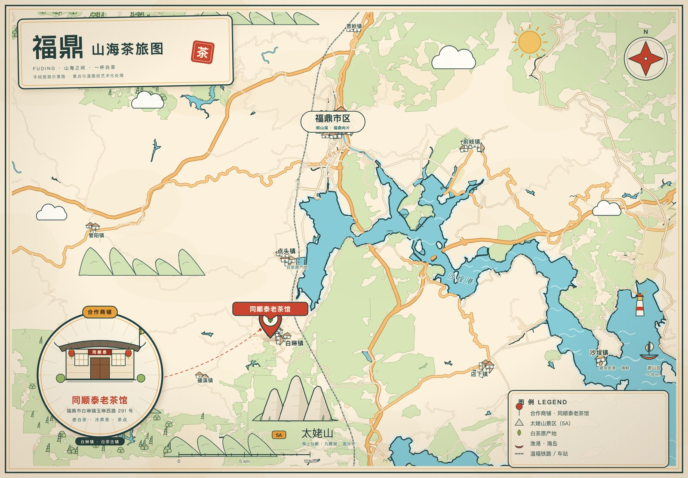

# 福鼎 · 山海茶旅图

一张用手绘风绘制的中文旅游地图：以福鼎市（福建宁德）的山、海、茶为主线，
并突出标注合作商铺 **同顺泰老茶馆**（福鼎市白琳镇玉琳西路 291 号）。



## 这张图是怎么画出来的

不用 GIS 软件，也不用设计软件。整条流水线是：

1. **取数**：从 [OpenFreeMap](https://openfreemap.org) 拉取 OpenStreetMap 矢量瓦片（z14），
   解码成海岸线、海湾、河流、道路、林地、居民区、地名和 POI（`collect.py`）。
2. **造形**：用 Python 把经纬度投影成画布坐标，生成 SVG 路径；海岸线、道路用
   `feTurbulence + feDisplacementMap` 滤镜做轻微"手抖"，得到手绘线稿感（`svgmap.py` / `svgbase.py`）。
3. **加戏**：山脊、太姥山石峰、茶舍、渔船、云、灯塔、指南针、图例等，都是代码画的
   矢量插画（`deco.py`）。
4. **出片**：无头 Chrome 以 2 倍像素密度截图，得到 3000 × 2086 的 PNG。

配色走"宣纸 + 青绿山水"：纸色 `#FBF1DC`、海水 `#86CBD6`、墨线 `#25403E`、朱砂 `#C9452F`。

## 快速开始

需要 Python 3.10+ 和 Google Chrome（用于截图）。

```bash
pip install -r requirements.txt

python3 collect.py    # 抓取矢量瓦片，约 1–2 分钟，输出到 data/geojson/
python3 svgmap.py     # 生成 output/fuding-map.svg，并截图 output/fuding-map.png
```

只改样式、不重新抓数据时，直接跑 `python3 svgmap.py` 即可。

Chrome 路径默认是 macOS 的安装位置，可用环境变量覆盖：

```bash
CHROME="/path/to/chrome" python3 svgmap.py
```

## 目录结构

```
collect.py      # OSM 矢量瓦片 -> GeoJSON 图层
render.py       # 读取图层、整理几何（海岸线、道路、林地……）
svgbase.py      # 投影与 SVG 路径工具
deco.py         # 手绘插画元件（山、茶舍、船、云、灯塔……）
svgmap.py       # 版面编排 + 生成 SVG/HTML + 调用 Chrome 截图
data/geojson/   # 已抓好的图层数据（可直接复用）
output/         # 成品 PNG / SVG
docs/preview.jpg
```

## 关于商铺位置

「同顺泰老茶馆」的坐标来自公开点评页面（高德 GCJ-02 坐标），已转换为 WGS84
（约 `120.1632, 27.1818`），落在白琳镇玉琳西路与岩东线的路口附近。
店铺本身不在 OSM 数据里，因此**图上位置为示意**；正式使用前建议用地图 App 复核门牌。

## 数据来源与版权

- 地图数据 © [OpenStreetMap contributors](https://www.openstreetmap.org/copyright)，遵循 ODbL 1.0。
- 矢量瓦片由 [OpenFreeMap](https://openfreemap.org)（开源项目）提供。
- 地图为**手绘示意图**：海岸线经过简化，道路与景点位置做了艺术化处理，
  不作为导航依据；比例尺仅表示大致尺度。

## License

- 代码：MIT（见 `LICENSE`）
- 地图数据与衍生数据（`data/`）：ODbL 1.0
